# QuizBlitz

A live, multiplayer quiz game. The host shows questions on a big screen; players join
on their phones by **scanning a QR code or typing a 6-digit game PIN**.

No dependencies: just Node.js 18 or newer.

## Demo

**[▶ Watch an 80-second game (MP4)](docs/media/quizblitz-demo.mp4)**: a real 3-player game recorded from the app
running locally. The host screen is on the left and one player's phone is on the right.

[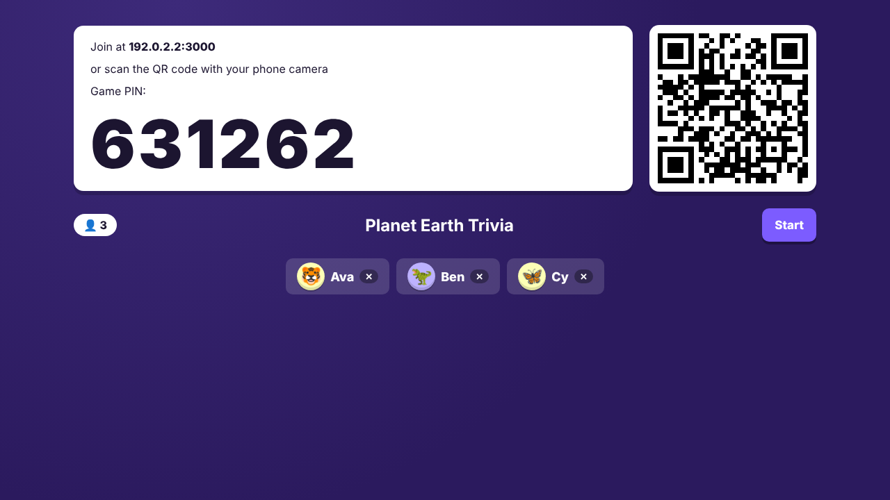](docs/media/quizblitz-demo.mp4)

**Host screen (big screen or projector)**

| Quiz editor | Question with live timer |
|---|---|
| 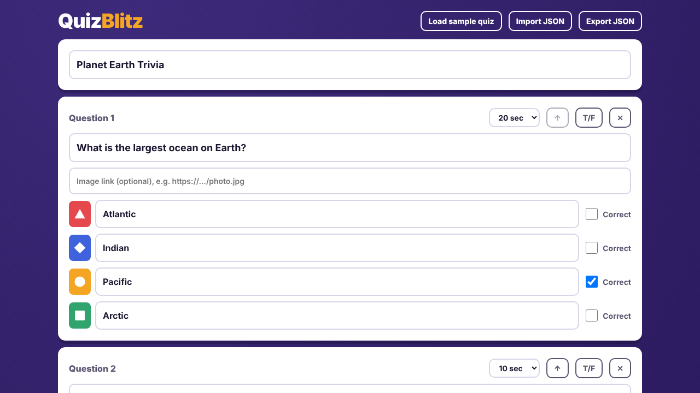 | 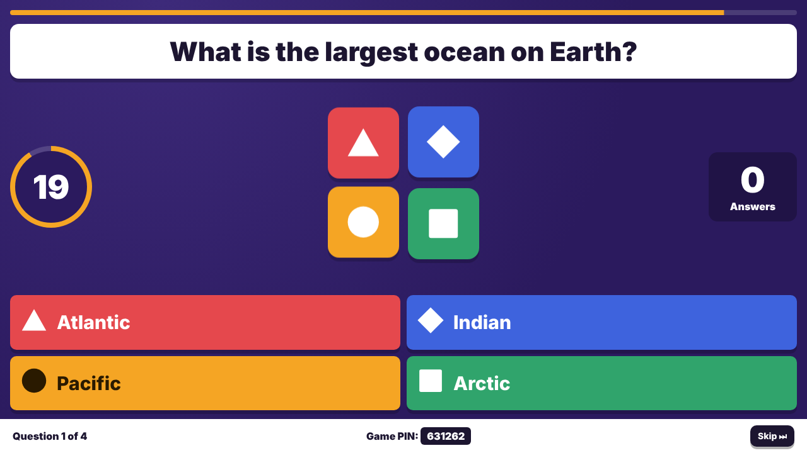 |
| **Answer reveal** | **Animated podium** |
| 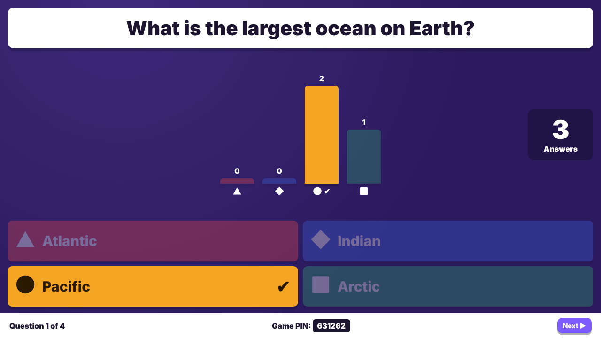 | 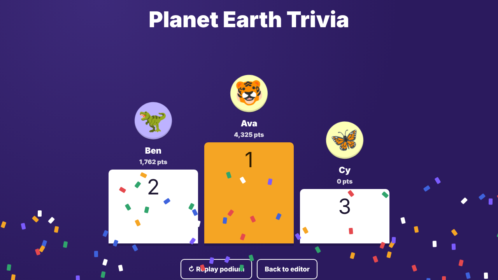 |

The scoreboard after each question is in [docs/media/15-host-scoreboard.png](docs/media/15-host-scoreboard.png).

**Player phone**

| Join | Pick an avatar | Answer | Correct | Wrong | Final place |
|---|---|---|---|---|---|
| 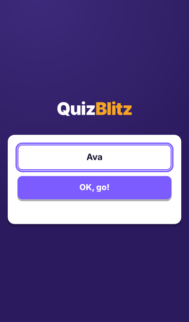 | 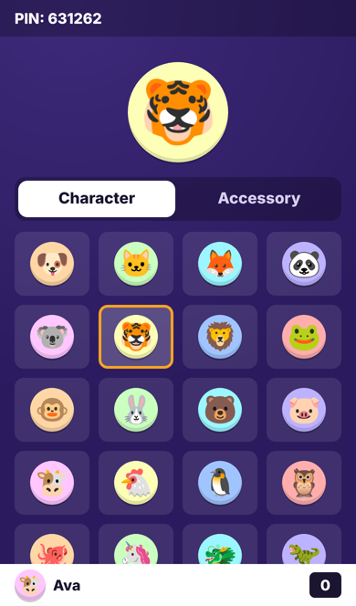 | 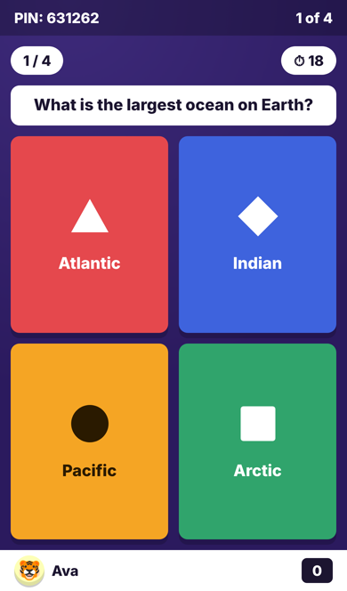 | 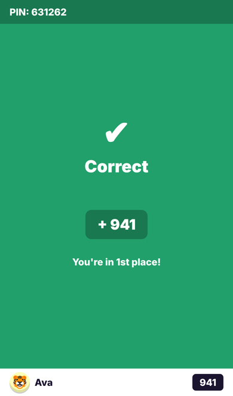 | 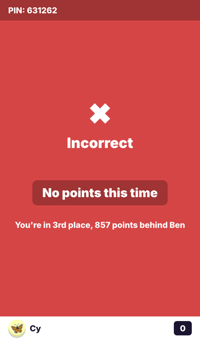 | 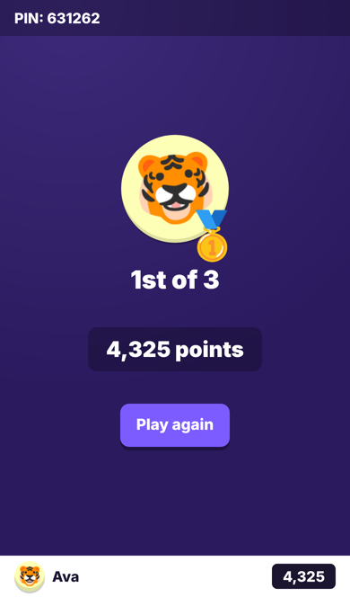 |

## Run it

```bash
node server.js
```

Then on the computer that will be the big screen, open **http://localhost:3000/host**.

1. Edit the quiz (or keep the sample), then click **Host live game**.
2. Players on the **same Wi-Fi** scan the QR code, or go to the address shown and enter the PIN.
3. Click **Start** when everyone's in. Use **Next** to move from answers to scoreboard to the next question.

> Windows may ask whether Node.js may accept network connections. Allow it on
> **private networks**, or phones won't be able to connect.
> To use a different port: `$env:PORT=8080; node server.js` (PowerShell).

## How a round works

| Phase | Host screen | Phone |
|---|---|---|
| Lobby | PIN, QR code, players joining | "You're in!" |
| Get ready (4 s) | Question text and countdown | Countdown |
| Question | Question, answers, timer, answer count | Coloured shape buttons |
| Reveal | Answer distribution and correct answer | Correct/Incorrect, points, streak, rank |
| Scoreboard | Top 5 | Your place |
| End | Podium and full leaderboard | Final place and score |

**Scoring:** a correct answer earns up to 1000 points, falling linearly to 500 at the
buzzer. Each consecutive correct answer after the first adds +100, up to +500.
Answer times are measured on the server, so a phone's clock can't affect speed points.

**Avatars:** every player gets their own animal character when they join, and can
change it (character and accessory) from the lobby. Avatars appear in the lobby,
scoreboard and podium.

**Podium:** the end screen reveals 3rd, then 2nd, then a drumroll and spotlight, then
1st with confetti, followed by the rest of the leaderboard. Use **Replay podium** to
show it again.

**Question images:** each question can have an optional image link, which is shown
in the middle of the host screen.

Players who refresh or whose phone sleeps rejoin automatically. The host can remove a
player by clicking ✕ on their name in the lobby.

## Project layout

```
server.js          game server: state machine, timers, scoring, REST + SSE
public/index.html  landing page (enter PIN)
public/host.*      quiz editor, lobby (PIN + QR), host game screens
public/play.*      player phone screens
public/shared.js   API, clock-sync and DOM helpers
public/style.css   shared styles
EVIDENCE.md        how this design was derived from analyzing Kahoot's player app
```

Quizzes are saved in the host browser's local storage, and can be exported or imported
as JSON:

```json
{ "title": "My quiz",
  "questions": [ { "text": "2 + 2 = ?", "choices": ["3", "4"], "correct": [1], "time": 20 } ] }
```

Games are kept in memory, so restarting the server ends them. QR code rendering
loads `qrcodejs` from cdnjs. Without internet the PIN and address still work.
